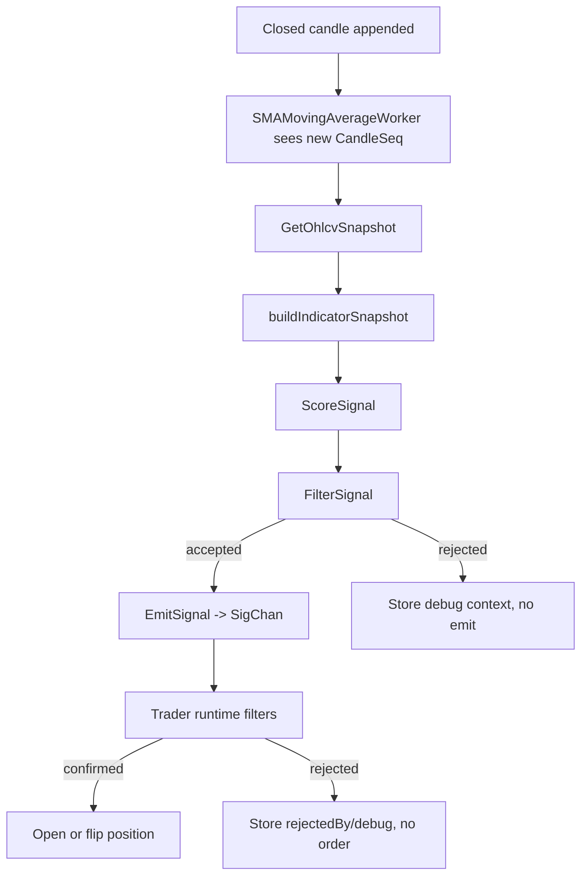

# Signal Generation Flow

This document describes the current signal path implemented in `strategy/strategy.go`.

The system uses explicit scoring and filtering stages rather than a priority chain:



## Indicator Snapshot

`SMAMovingAverageWorker` runs once per second and only processes a new closed candle sequence once. It reads candle data through `State.GetOhlcvSnapshot()`, so indicator calculation uses copied OHLCV slices rather than live mutable state.

`buildIndicatorSnapshot` records:

- last close price;
- SMA over the recent `SmaLen` window;
- RSI(14);
- MACD line, signal line, and histogram;
- ATR(14);
- Bollinger Bands with window 20 and multiplier 2.0;
- higher timeframe bias from the configured HTF window.

Additional diagnostic-only fields are also recorded for future `reversal_long` analysis:

- `volume_ratio`;
- `rsi_delta`;
- `macd_hist_delta`;
- `bb_position`;
- `was_below_lower_bb`;
- `returned_inside_bb`.

These fields are currently diagnostic only and do not affect signal generation, filtering, or execution.

## Scoring

`ScoreSignal(snapshot)` calculates `longScore`, `shortScore`, and per-side reasons. Scoring factors do not hard-block a side.

The adaptive deadband is based on market regime:

- base deadband is `0.005`;
- in `trend` regime base deadband is `0.01`;
- if ATR is available, `adaptiveDeadband` uses at least `ATR * AtrDeadbandMult`.

In `trend` regime:

- LONG `+1` for `sma-breakout` when `close > SMA + deadband`;
- SHORT `+1` for `sma-breakdown` when `close < SMA - deadband`;
- LONG `+1` for `macd-trend` when MACD histogram is positive and MACD line is above signal;
- SHORT `+1` for `macd-trend` when MACD histogram is negative and MACD line is below signal;
- LONG `+1` for `bb-breakout` when `close >= BBUpper + deadband`;
- SHORT `+1` for `bb-breakout` when `close <= BBLower - deadband`.

In `range` regime:

- LONG `+1` for `bb-revert` when `close <= BBLower - deadband`;
- SHORT `+1` for `bb-revert` when `close >= BBUpper + deadband`;
- LONG `+1` for `sma-revert` when `close < SMA - deadband`;
- SHORT `+1` for `sma-revert` when `close > SMA + deadband`;
- LONG `+1` for `macd-mean` when MACD histogram is negative;
- SHORT `+1` for `macd-mean` when MACD histogram is positive.

RSI contributes to score only when `RSI_MODE=score`:

- LONG `+1` for `rsi-oversold` when `RSI <= RSILow`;
- SHORT `+1` for `rsi-overbought` when `RSI >= RSIHigh`;
- LONG `+1` for `rsi-div-bull` when recent price falls while RSI rises;
- SHORT `+1` for `rsi-div-bear` when recent price rises while RSI falls.

Orderbook data does not add score in the current pipeline.

## Hard Filters

`FilterSignal(scoredSignal)` applies hard filters after scoring. These filters do not change `longScore` or `shortScore`; they only reject a side or the whole signal and write structured debug context.

Pre-emit filters:

- `rsi_filter`: active only when `RSI_MODE=filter`.
  - LONG is allowed when `RSI <= RSILow`.
  - SHORT is allowed when `RSI >= RSIHigh`.
  - If RSI is unavailable and evaluates to `0`, the filter records `filter_no_value` and does not block either side.
- `htf_filter`: if HTF bias is `LONG`, SHORT is rejected; if HTF bias is `SHORT`, LONG is rejected.
- direction selection: only sides with score greater than zero and not rejected by side filters are candidates.
- `orderbook_confirmation`: the chosen side must pass orderbook confirmation before emit.

Runtime filters in `Trader()`:

- `grace_period`: blocks flips or new handling while the configured grace period after entry is active.
- `minimum_price_delta`: blocks re-entry or flip when price has not moved far enough to cover the configured fee buffer multiple.
- `cooldown`: blocks same-side re-entry during `ReentryCooldownSec`.
- `duplicate_position`: blocks repeated same-side signal when a position on that side is already open.
- `orderbook_confirmation`: normally uses the precomputed result attached to the signal; it falls back to evaluating only if the signal has no valid result or the side mismatches.
- `minimum_strength`: accumulates emitted signal strength per direction per candle and requires `SignalStrengthThreshold` before opening. High-confidence signals use threshold `1`.

## Direction Selection

After side filters, direction is deterministic:

- if only LONG remains with `longScore > 0`, choose LONG;
- if only SHORT remains with `shortScore > 0`, choose SHORT;
- if both remain, choose LONG only when `longScore > shortScore`;
- choose SHORT only when `shortScore > longScore`;
- if scores are equal and positive, reject with `tie_strength_no_signal`;
- if both scores are zero, reject with `no_score`.

Equal strength never randomly selects LONG or SHORT.

## RSI Modes

`RSI_MODE` can be `off`, `log`, `filter`, or `score`. The default is `filter` for explicit backwards compatibility.

- `off`: RSI is calculated in the snapshot, but it does not affect score or filtering.
- `log`: RSI is included in debug/reasons only.
- `filter`: RSI is a hard side filter and does not add score.
- `score`: RSI adds scoring reasons and does not hard-block a side.

## Planned Reversal Long

`reversal_long` is planned as a separate detection mode for V-shaped rebounds after capitulation moves.
The current code keeps it disabled by default. `Enabled` controls diagnostics, while `TradeEnabled` controls whether a ready diagnostic candidate may enter the real signal pipeline.
Both are disabled for trading by default, and `Enabled=true` alone remains diagnostics-only.
The detector does not execute orders directly and does not relax the ordinary `rsi_filter`, `htf_filter`, or `orderbook_confirmation`.

## ReversalLongDetector

`ReversalLongDetector` tracks potential V-shaped rebound states with the diagnostic fields from `IndicatorSnapshot`.

- `idle`;
- `capitulated`;
- `below_lower_bb`;
- `reclaimed_bb`;
- `momentum_turn`;
- `candidate_ready`;
- `expired`.

The diagnostic candidate requires:

- capitulation from oversold RSI or volume spike;
- lower Bollinger Band reclaim when configured;
- RSI recovery while entry RSI is still below the configured max;
- MACD histogram recovery when configured;
- no new low for the configured number of bars;
- score above the configured threshold.

Score breakdown is logged as:

- `score_rsi_oversold`;
- `score_volume_spike`;
- `score_bb_reclaim`;
- `score_rsi_recovery`;
- `score_macd_recovery`;
- `score_no_new_low`.

The detector also has diagnostic-only safety gates:

- Reversal HTF check: unavailable HTF does not block; bearish HTF can be allowed by `AllowHTFBearish`; extreme downtrend blocks when `BlockExtremeHTFDowntrend=true`.
- Reversal soft orderbook check: checks whether the book is not hostile by spread, ask wall, bid stability, and severe anti-LONG imbalance. It does not require strict bullish confirmation.

These checks are separate from the existing `htf_filter` and `orderbook_confirmation`.
Runtime HTF uses the existing `IndicatorSnapshot.HTFBias`.
Runtime soft orderbook uses the in-memory book snapshot when bids/asks are present; otherwise it logs `orderbook_available=false` and does not block diagnostic evaluation.

The log event is `reversal_long_evaluation` and is emitted only when `reversal_long.enabled=true`.
`CandidateReady=true` is diagnostic only unless `TradeEnabled=true`.
When `TradeEnabled=true`, the main SMA signal cycle may convert a ready candidate into a regular LONG signal tagged with `ModeReversalLong`.
That bridge runs after ordinary `FilterSignal` output: accepted ordinary LONG wins, ordinary SHORT conflicts block reversal, and reversal never emits simultaneously with SHORT.
Reversal signals still use the common `EmitSignal -> State.SigChan -> Trader` path and carry the detector-approved soft orderbook result; the detector itself never writes to `SigChan`.
The pipeline decision log event is `reversal_long_pipeline_decision`.
There is no new goroutine, executor, or direct order path.

## Reversal Long Runtime Profile

`ModeReversalLong` uses the common signal/trader/execution path, but `Trader()` applies a separate conservative runtime profile before the shared `openPosition` call.

- `TradeEnabled=false` blocks reversal signals even if one reaches runtime unexpectedly.
- Runtime strength uses `max(SignalStrengthThreshold, ReversalLong.MinRuntimeStrength)`.
- A local-low stop is required when `RequireStop=true`.
- The stop is derived from `reversal_lowest_low * (1 - StopBelowLocalLowBps / 10000)`.
- Position size is reduced by `PositionSizeMultiplier`; invalid multipliers fall back to `0.3` and never increase size above ordinary LONG sizing.
- Runtime orderbook uses the reversal soft orderbook gate instead of the strict trend confirmation fallback.
- Ordinary LONG/SHORT continue to use the existing strict runtime `orderbook_confirmation`.
- Reversal TP still uses the existing TP solver, while SL is pinned to the local-low stop and cannot be loosened below that stop.
- `TimeoutBars` is stored and logged for reversal signals; full timeout exit lifecycle is not integrated yet.

Runtime logs:

- `event=reversal_long_runtime_gate`;
- `event=reversal_long_risk`;
- `event=reversal_long_tpsl`.

Safety tests cover:

- `TradeEnabled=false` diagnostic-only behavior;
- `ModeReversalLong` propagation through the common pipeline;
- local-low stop requirement;
- conservative position sizing;
- soft runtime orderbook gate;
- no direct execution from detector;
- unchanged ordinary LONG/SHORT behavior.

Offline replay is documented in `docs/reversal_long_replay.md`.

## Orderbook Confirmation

Orderbook confirmation is evaluated once for the generated signal in `FilterSignal` and saved in `Signal.Orderbook`.

The ratio is side-dependent:

- LONG uses `topBidDepth / topAskDepth`;
- SHORT uses `topAskDepth / topBidDepth`.

`OrderbookStrengthThreshold` is compared against that ratio. A value of `1.0` means balanced top-book depth; the default threshold is above `1.0`, so the requested side must dominate. The result also includes side-specific imbalance history (`long` or `short`) and a textual reason.

`Trader()` should use the saved `Signal.Orderbook` result. It only re-evaluates orderbook if the signal does not contain an evaluated result for the selected side.

## Debug Context

Each signal carries `Signal.Debug`:

- `longScore`;
- `shortScore`;
- `chosenDirection`;
- `appliedFilters`;
- `rejectedBy`;
- `reasons`;
- diagnostic fields such as `volumeRatio`, `rsiDelta`, `macdHistDelta`, `bbPosition`, `wasBelowLowerBB`, and `returnedInsideBB`.

Rejected signals can still update `LastSignal` for diagnostics, including `/status`.

## Examples

### LONG Signal

Scenario:

- regime is `trend`;
- `close > SMA + deadband`;
- MACD histogram is positive and line is above signal;
- `close >= BBUpper + deadband`;
- `RSI_MODE=filter` and `RSI <= RSILow`;
- HTF bias is `LONG`;
- orderbook LONG ratio is `1.30` with threshold `1.20`.

Result:

```text
longScore=3
shortScore=0
chosenDirection=LONG
appliedFilters=[rsi_filter htf_filter orderbook_confirmation]
rejectedBy=[]
reasons=[LONG:sma-breakout LONG:macd-trend LONG:bb-breakout ...]
```

The signal is emitted to `Trader()`. The trader still must pass runtime filters such as `minimum_strength`.

### SHORT Signal

Scenario:

- regime is `trend`;
- `close < SMA - deadband`;
- MACD histogram is negative and line is below signal;
- `close <= BBLower - deadband`;
- `RSI_MODE=filter` and `RSI >= RSIHigh`;
- HTF bias is `SHORT`;
- orderbook SHORT ratio is `1.25` with threshold `1.20`.

Result:

```text
longScore=0
shortScore=3
chosenDirection=SHORT
appliedFilters=[rsi_filter htf_filter orderbook_confirmation]
rejectedBy=[]
reasons=[SHORT:sma-breakdown SHORT:macd-trend SHORT:bb-breakout ...]
```

### Rejected Signal: Tie

Scenario:

- LONG score is `2`;
- SHORT score is `2`;
- `RSI_MODE` is `off`, `log`, or `score`;
- HTF bias is empty.

Result:

```text
longScore=2
shortScore=2
chosenDirection=
appliedFilters=[]
rejectedBy=[tie_strength_no_signal]
reasons=[tie_strength_no_signal: long=2 short=2 ...]
```

No signal is emitted.

### Rejected Signal: Orderbook

Scenario:

- LONG score is `3`;
- LONG passes RSI and HTF filters;
- orderbook LONG ratio is `0.80` with threshold `1.20`.

Result:

```text
longScore=3
shortScore=0
chosenDirection=LONG
appliedFilters=[rsi_filter orderbook_confirmation]
rejectedBy=[orderbook_confirmation]
reasons=[... LONG:orderbook_rejected reason=ratio 0.80 below 1.20]
```

No signal is emitted to `Trader()`.
