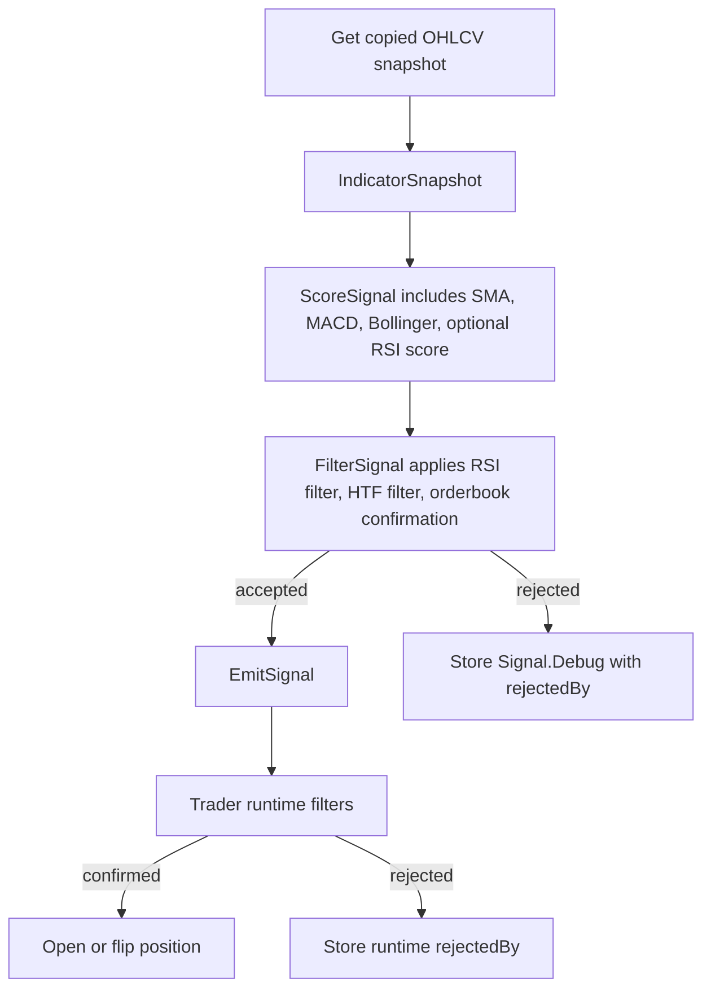

# Signal Generation Flow With Bollinger Bands

This file is kept for links that used to point to the old "with Bollinger Bands" flow. The current implementation does not have a separate Bollinger fallback stage. Bollinger Bands are part of the normal `ScoreSignal` stage described in [signal_generation_flow.md](signal_generation_flow.md).

## Current Bollinger Role

Bollinger Bands are calculated in `buildIndicatorSnapshot` with window `20` and multiplier `2.0`. They are then used only as scoring inputs:

- in `trend` regime:
  - LONG `+1` for `bb-breakout` when `close >= BBUpper + deadband`;
  - SHORT `+1` for `bb-breakout` when `close <= BBLower - deadband`;
- in `range` regime:
  - LONG `+1` for `bb-revert` when `close <= BBLower - deadband`;
  - SHORT `+1` for `bb-revert` when `close >= BBUpper + deadband`.

Bollinger Bands do not bypass RSI, HTF, orderbook, cooldown, grace-period, or minimum-strength filters.

## Pipeline



## Examples

### Bollinger LONG Contribution

In `trend` regime, if `close >= BBUpper + deadband`, `ScoreSignal` adds:

```text
LONG +1 reason=bb-breakout
```

This can help LONG win direction selection, but the signal still needs to pass hard filters such as RSI filter mode and orderbook confirmation.

### Bollinger SHORT Contribution

In `range` regime, if `close >= BBUpper + deadband`, `ScoreSignal` adds:

```text
SHORT +1 reason=bb-revert
```

This is a scoring reason, not an immediate order instruction.

### Rejected Despite Bollinger Score

If a LONG candidate has `bb-breakout` and other LONG score reasons but orderbook ratio is below `OrderbookStrengthThreshold`, the final debug context looks like:

```text
chosenDirection=LONG
appliedFilters=[orderbook_confirmation]
rejectedBy=[orderbook_confirmation]
reasons=[... LONG:orderbook_rejected reason=ratio 0.80 below 1.20]
```

No signal is emitted to `Trader()`.
